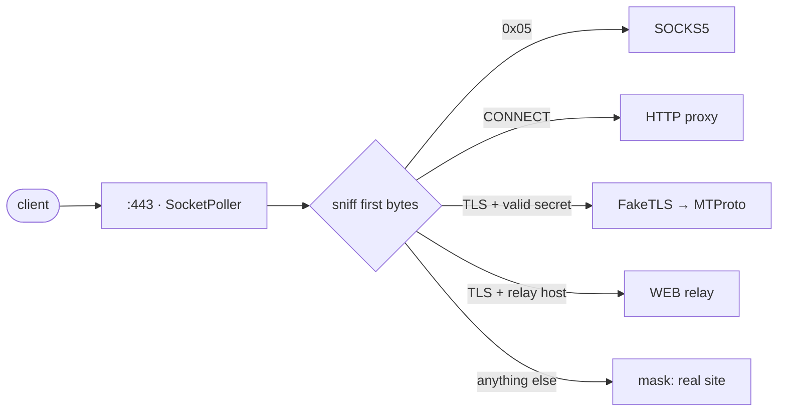

Un proxy nativo y pequeño para Telegram: MTProto, SOCKS5 y WEB en un solo binario. Escrito en <a href="https://github.com/yukitsuri/yukino">Yukino</a>.

<a href="README.md">English</a> · <a href="README.ru.md">Русский</a> · <a href="README.zh-CN.md">简体中文</a> · <b>Español</b> · <a href="README.tr.md">Türkçe</a> · <a href="README.fa.md">فارسی</a>

> <b>Estado: pre-alfa, fase de diseño.</b> Aún no hay binarios publicados. Este README describe objetivos y plan.

<table>
<tr><td align="center" width="25%"></td><td align="center" width="25%"></td><td align="center" width="25%"></td><td align="center" width="25%"></td></tr>
<tr><td valign="top" align="center">Secretos <code>dd</code> / <code>ee</code>, FakeTLS, varios usuarios.</td><td valign="top" align="center">Llamadas de Telegram. Autenticación, ACL, límites.</td><td valign="top" align="center">Relay para el tipo de proxy WEB de Telegram Desktop 7.1+, sobre HTTPS normal.</td><td valign="top" align="center">¿Secreto incorrecto o sondeo? El otro lado recibe el sitio real.</td></tr>
</table>

## Carencias detectadas → qué hace ypwee

<table>
<tr><th width="50%">Carencia de los proxies actuales</th><th width="50%">ypwee</th></tr>
<tr><td valign="top">Un protocolo por herramienta. mtproto.zig ofrece MTProto + WEB pero indica que no admite llamadas (sin SOCKS5); tg-ws-proxy-rs es un puente local para Desktop.</td><td valign="top">MTProto, SOCKS5 y WEB en un binario, un puerto y una configuración.</td></tr>
<tr><td valign="top">Builds pesados. Según la tabla del propio mtproto.zig: Telemt ≈ 15 MB / 423 crates, mtg ≈ 13 MB.</td><td valign="top">Binario nativo de Yukino: sin VM ni GC de trazado. Mediremos y publicaremos tamaño y RAM, sin prometerlos.</td></tr>
<tr><td valign="top">Crecimiento de memoria con muchas conexiones retenidas (tg-ws-proxy-rs, issues #97 y #113).</td><td valign="top">Estado pequeño y fijo por conexión, asignación por regiones, pruebas de resistencia en CI.</td></tr>
<tr><td valign="top">Dependencia en ejecución de listas de terceros (tg-ws-proxy-rs puede descargar una lista de dominios de Cloudflare desde GitHub).</td><td valign="top">Autónomo. Sin descargas al arrancar.</td></tr>
<tr><td valign="top"><code>curl | sudo bash</code> como vía principal de instalación.</td><td valign="top">Builds de GitHub Actions, sumas SHA-256, atestación de procedencia, instalación con tarball.</td></tr>
<tr><td valign="top">SOCKS5 no se puede disfrazar de HTTPS.</td><td valign="top">Lo decimos claro: SOCKS5 es opcional, autenticado y con límites.</td></tr>
</table>

## Cómo un puerto sirve todo

## Hoja de ruta

- <b>M0</b> — diseño, README, esqueleto de CI
- <b>M1</b> — SOCKS5 + HTTP CONNECT (mínimo viable; valida <code>std.net</code> + <code>SocketPoller</code>)
- <b>M2</b> — MTProto obfuscated2 (requiere AES-256-CTR, aún ausente en <code>std.crypto</code> de Yukino) + secretos <code>dd</code>/<code>ee</code>
- <b>M3</b> — FakeTLS + enmascaramiento anti-sondeo
- <b>M4</b> — relay WEB (WebSocket RFC 6455 + tramas del puente de Telegram)
- <b>M5</b> — releases firmados, instalador, benchmarks frente a mtg / Telemt / mtproto.zig

## Créditos y referencias

- [Yukino](https://github.com/yukitsuri/yukino) — language, `std.net`, `std.crypto`
- [sleep3r/mtproto.zig](https://github.com/sleep3r/mtproto.zig) — MTProto + WEB relay in Zig (MIT)
- [valnesfjord/tg-ws-proxy-rs](https://github.com/valnesfjord/tg-ws-proxy-rs) · [Flowseal/tg-ws-proxy](https://github.com/Flowseal/tg-ws-proxy) — WebSocket bridge
- Telemt (Rust) · mtg (Go) · official MTProxy (C)

*Licencia: por decidir (Yukino es Apache-2.0; el código portado de proyectos MIT conserva sus avisos).*
