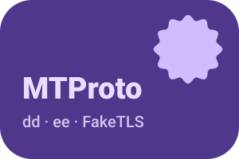
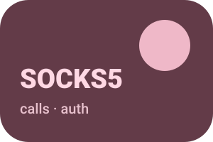
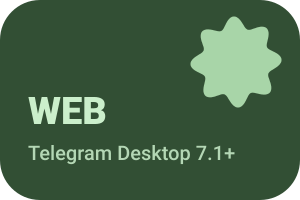
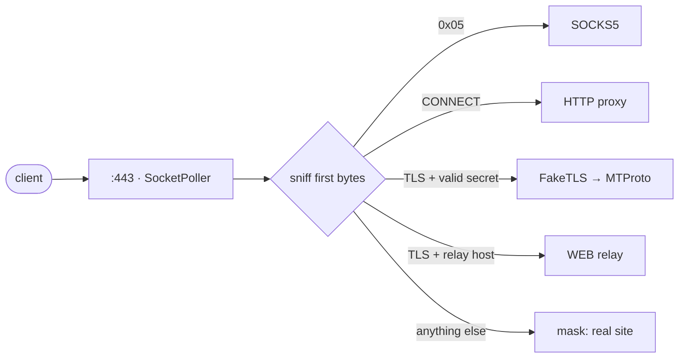

یک پروکسی بومیِ کوچک برای تلگرام — MTProto، SOCKS5 و WEB در یک فایل اجرایی. نوشته‌شده با <a href="https://github.com/yukitsuri/yukino">Yukino</a>.

<a href="README.md">English</a> · <a href="README.ru.md">Русский</a> · <a href="README.zh-CN.md">简体中文</a> · <a href="README.es.md">Español</a> · <a href="README.tr.md">Türkçe</a> · <b>فارسی</b>

> <b>وضعیت: pre-alpha، مرحلهٔ طراحی.</b> هنوز فایل اجرایی منتشر نشده است. این README اهداف و برنامه را شرح می‌دهد.

<table dir="rtl">
<tr><td align="center" width="25%"></td><td align="center" width="25%"></td><td align="center" width="25%"></td><td align="center" width="25%"></td></tr>
<tr><td valign="top" align="center">سکرت‌های <code>dd</code> / <code>ee</code>، FakeTLS، چند کاربر.</td><td valign="top" align="center">تماس‌های تلگرام. احراز هویت با گذرواژه، ACL، محدودیت نرخ.</td><td valign="top" align="center">رله برای نوع پروکسی WEB در Telegram Desktop 7.1+ روی HTTPS معمولی.</td><td valign="top" align="center">سکرت اشتباه یا پروب فعال؟ طرف مقابل وب‌سایت واقعی را می‌بیند.</td></tr>
</table>

## کمبودهایی که یافتیم ← کاری که ypwee می‌کند

<table dir="rtl">
<tr><th width="50%">کمبود پروکسی‌های موجود</th><th width="50%">ypwee</th></tr>
<tr><td valign="top">هر ابزار فقط یک پروتکل. mtproto.zig از MTProto + WEB پشتیبانی می‌کند ولی تماس را پشتیبانی نمی‌کند (بدون SOCKS5)؛ tg-ws-proxy-rs یک پل محلی برای Desktop است.</td><td valign="top">MTProto، SOCKS5 و WEB در یک فایل اجرایی، یک پورت و یک پیکربندی.</td></tr>
<tr><td valign="top">ساخت‌های سنگین. طبق جدول خود mtproto.zig: Telemt ≈ ۱۵ مگابایت / ۴۲۳ crate و mtg ≈ ۱۳ مگابایت.</td><td valign="top">فایل بومی Yukino — بدون ماشین مجازی و بدون GC ردیاب. حجم و RAM اندازه‌گیری و منتشر می‌شود، نه وعده.</td></tr>
<tr><td valign="top">رشد حافظه با اتصال‌های زیادِ نگه‌داشته‌شده (tg-ws-proxy-rs، issue های #97 و #113).</td><td valign="top">وضعیت کوچک و ثابت برای هر اتصال، تخصیص ناحیه‌ای، تست‌های طولانی در CI.</td></tr>
<tr><td valign="top">وابستگی زمان‌اجرا به فهرست‌های شخص ثالث (tg-ws-proxy-rs می‌تواند فهرست دامنه‌های Cloudflare را از GitHub بگیرد).</td><td valign="top">مستقل. هنگام راه‌اندازی هیچ دریافت از راه دور نیست.</td></tr>
<tr><td valign="top"><code>curl | sudo bash</code> به‌عنوان راه اصلی نصب.</td><td valign="top">ساخت‌های GitHub Actions، SHA-256، گواهی منشأ، نصب ساده با tarball.</td></tr>
<tr><td valign="top">SOCKS5 را نمی‌شود شبیه HTTPS کرد.</td><td valign="top">صادقانه: SOCKS5 اختیاری، دارای احراز هویت و محدودیت نرخ است.</td></tr>
</table>

## یک پورت چگونه همه‌چیز را سرویس می‌دهد

## نقشهٔ راه

- <b>M0</b> — طراحی، README، اسکلت CI
- <b>M1</b> — SOCKS5 + HTTP CONNECT (کوچک‌ترین برش؛ آزمون <code>std.net</code> و <code>SocketPoller</code>)
- <b>M2</b> — MTProto obfuscated2 (نیاز به AES-256-CTR دارد که هنوز در <code>std.crypto</code> یوکینو نیست) + سکرت‌های <code>dd</code>/<code>ee</code>
- <b>M3</b> — FakeTLS + پنهان‌سازی در برابر پروب فعال
- <b>M4</b> — رلهٔ WEB (WebSocket RFC 6455 + فریم‌های پل تلگرام)
- <b>M5</b> — انتشار امضاشده، نصب‌کننده، بنچمارک در برابر mtg / Telemt / mtproto.zig

## منابع و قدردانی

- [Yukino](https://github.com/yukitsuri/yukino) — language, `std.net`, `std.crypto`
- [sleep3r/mtproto.zig](https://github.com/sleep3r/mtproto.zig) — MTProto + WEB relay in Zig (MIT)
- [valnesfjord/tg-ws-proxy-rs](https://github.com/valnesfjord/tg-ws-proxy-rs) · [Flowseal/tg-ws-proxy](https://github.com/Flowseal/tg-ws-proxy) — WebSocket bridge
- Telemt (Rust) · mtg (Go) · official MTProxy (C)

*مجوز: هنوز تعیین نشده (خود Yukino تحت Apache-2.0 است؛ کدِ برگرفته از پروژه‌های MIT باید اعلان آن‌ها را حفظ کند).*

