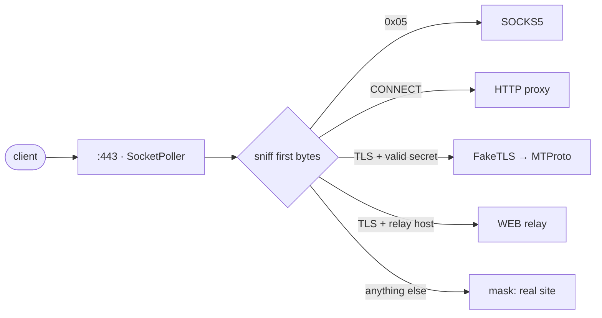

One small native proxy for Telegram — MTProto, SOCKS5 and WEB in a single binary. Written in <a href="https://github.com/yukitsuri/yukino">Yukino</a>.

<b>English</b> · <a href="README.ru.md">Русский</a> · <a href="README.zh-CN.md">简体中文</a> · <a href="README.es.md">Español</a> · <a href="README.tr.md">Türkçe</a> · <a href="README.fa.md">فارسی</a>

> <b>Status: pre-alpha, design stage.</b> There is no released binary yet. This README describes goals and the plan.

<table>
<tr><td align="center" width="25%"></td><td align="center" width="25%"></td><td align="center" width="25%"></td><td align="center" width="25%"></td></tr>
<tr><td valign="top" align="center">Secrets <code>dd</code> / <code>ee</code>, FakeTLS, several users.</td><td valign="top" align="center">Telegram calls. Password auth, ACL, rate limits.</td><td valign="top" align="center">Relay for the WEB proxy type of Telegram Desktop 7.1+, over ordinary HTTPS.</td><td valign="top" align="center">Wrong secret or a probe? The peer gets the real website.</td></tr>
</table>

## Gaps we found → what ypwee does

<table>
<tr><th width="50%">Gap in existing proxies</th><th width="50%">ypwee</th></tr>
<tr><td valign="top">One protocol per tool. mtproto.zig does MTProto + WEB but says calls are unsupported (no SOCKS5); tg-ws-proxy-rs is a local bridge for Desktop.</td><td valign="top">MTProto, SOCKS5 and WEB in one binary, one port, one config.</td></tr>
<tr><td valign="top">Heavy builds. By mtproto.zig's own table: Telemt ≈ 15 MB / 423 crates, mtg ≈ 13 MB.</td><td valign="top">Native Yukino binary — no VM, no tracing GC. Size and RAM numbers will be measured and published, not promised.</td></tr>
<tr><td valign="top">Memory growth with many held connections (tg-ws-proxy-rs issues #97, #113).</td><td valign="top">Small fixed per-connection state, region allocation, soak tests in CI.</td></tr>
<tr><td valign="top">Runtime dependence on third-party lists (tg-ws-proxy-rs can fetch a Cloudflare domain list from GitHub).</td><td valign="top">Self-contained. No remote fetch at startup.</td></tr>
<tr><td valign="top"><code>curl | sudo bash</code> as the main install path.</td><td valign="top">GitHub Actions release builds, SHA-256 sums, provenance attestation, plain tarball install.</td></tr>
<tr><td valign="top">SOCKS5 cannot be disguised as HTTPS.</td><td valign="top">Said honestly: SOCKS5 is opt-in, authenticated and rate-limited.</td></tr>
</table>

## How one port serves everything

## Roadmap

- <b>M0</b> — design, README, CI skeleton
- <b>M1</b> — SOCKS5 + HTTP CONNECT (smallest slice; proves <code>std.net</code> + <code>SocketPoller</code>)
- <b>M2</b> — MTProto obfuscated2 (needs AES-256-CTR, not in Yukino <code>std.crypto</code> yet) + <code>dd</code>/<code>ee</code> secrets
- <b>M3</b> — FakeTLS + anti-probe masking
- <b>M4</b> — WEB relay (WebSocket RFC 6455 + Telegram bridge frames)
- <b>M5</b> — signed releases, installer, benchmarks vs. mtg / Telemt / mtproto.zig

## Credits & references

- [Yukino](https://github.com/yukitsuri/yukino) — language, `std.net`, `std.crypto`
- [sleep3r/mtproto.zig](https://github.com/sleep3r/mtproto.zig) — MTProto + WEB relay in Zig (MIT)
- [valnesfjord/tg-ws-proxy-rs](https://github.com/valnesfjord/tg-ws-proxy-rs) · [Flowseal/tg-ws-proxy](https://github.com/Flowseal/tg-ws-proxy) — WebSocket bridge
- Telemt (Rust) · mtg (Go) · official MTProxy (C)

*License: to be decided (Yukino itself is Apache-2.0; code ported from MIT projects must keep their notices).*
