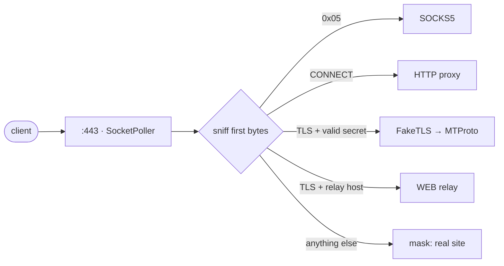

Маленький нативный прокси для Telegram — MTProto, SOCKS5 и WEB в одном бинарнике. Написан на <a href="https://github.com/yukitsuri/yukino">Yukino</a>.

<a href="README.md">English</a> · <b>Русский</b> · <a href="README.zh-CN.md">简体中文</a> · <a href="README.es.md">Español</a> · <a href="README.tr.md">Türkçe</a> · <a href="README.fa.md">فارسی</a>

> <b>Статус: pre-alpha, стадия дизайна.</b> Готового бинарника пока нет. README описывает цели и план.

<table>
<tr><td align="center" width="25%"></td><td align="center" width="25%"></td><td align="center" width="25%"></td><td align="center" width="25%"></td></tr>
<tr><td valign="top" align="center">Секреты <code>dd</code> / <code>ee</code>, FakeTLS, несколько пользователей.</td><td valign="top" align="center">Звонки Telegram. Пароль, ACL, лимиты.</td><td valign="top" align="center">Релей для WEB-прокси Telegram Desktop 7.1+ поверх обычного HTTPS.</td><td valign="top" align="center">Неверный секрет или проба? Отдаём настоящий сайт.</td></tr>
</table>

## Какие дыры нашли → что делает ypwee

<table>
<tr><th width="50%">Слабое место существующих</th><th width="50%">ypwee</th></tr>
<tr><td valign="top">Один протокол на инструмент. mtproto.zig: MTProto + WEB, но звонки не поддерживаются (нет SOCKS5); tg-ws-proxy-rs — локальный мост для Desktop.</td><td valign="top">MTProto, SOCKS5 и WEB в одном бинарнике, на одном порту, с одним конфигом.</td></tr>
<tr><td valign="top">Тяжёлые сборки. По таблице самого mtproto.zig: Telemt ≈ 15 МБ / 423 crate, mtg ≈ 13 МБ.</td><td valign="top">Нативный бинарник на Yukino — без VM и tracing GC. Размер и RAM будем измерять и публиковать, а не обещать.</td></tr>
<tr><td valign="top">Рост памяти при множестве удерживаемых соединений (tg-ws-proxy-rs, issues #97, #113).</td><td valign="top">Маленькое фиксированное состояние на соединение, регионы, soak-тесты в CI.</td></tr>
<tr><td valign="top">Зависимость от сторонних списков в рантайме (tg-ws-proxy-rs может подтягивать список доменов Cloudflare с GitHub).</td><td valign="top">Автономность. Никаких загрузок при старте.</td></tr>
<tr><td valign="top"><code>curl | sudo bash</code> как основной способ установки.</td><td valign="top">Релизы из GitHub Actions, SHA-256, provenance-аттестация, обычный tarball.</td></tr>
<tr><td valign="top">SOCKS5 нельзя замаскировать под HTTPS.</td><td valign="top">Честно: SOCKS5 — по желанию, с авторизацией и лимитами.</td></tr>
</table>

## Как один порт обслуживает всё

## Дорожная карта

- <b>M0</b> — дизайн, README, скелет CI
- <b>M1</b> — SOCKS5 + HTTP CONNECT (минимальный срез; проверяет <code>std.net</code> + <code>SocketPoller</code>)
- <b>M2</b> — MTProto obfuscated2 (нужен AES-256-CTR, его пока нет в <code>std.crypto</code> Yukino) + секреты <code>dd</code>/<code>ee</code>
- <b>M3</b> — FakeTLS + маскировка от активных проб
- <b>M4</b> — WEB-релей (WebSocket RFC 6455 + кадры моста Telegram)
- <b>M5</b> — подписанные релизы, установщик, бенчмарки против mtg / Telemt / mtproto.zig

## Источники и вдохновение

- [Yukino](https://github.com/yukitsuri/yukino) — language, `std.net`, `std.crypto`
- [sleep3r/mtproto.zig](https://github.com/sleep3r/mtproto.zig) — MTProto + WEB relay in Zig (MIT)
- [valnesfjord/tg-ws-proxy-rs](https://github.com/valnesfjord/tg-ws-proxy-rs) · [Flowseal/tg-ws-proxy](https://github.com/Flowseal/tg-ws-proxy) — WebSocket bridge
- Telemt (Rust) · mtg (Go) · official MTProxy (C)

*Лицензия: пока не выбрана (сам Yukino — Apache-2.0; код, портированный из MIT-проектов, сохраняет их уведомления).*
