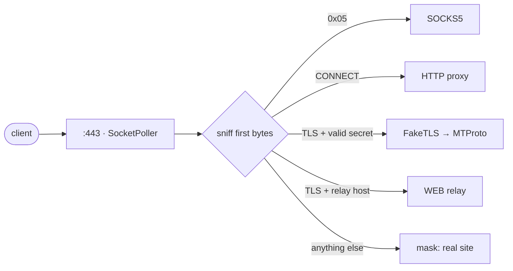

Telegram için küçük, yerel bir proxy — tek ikilide MTProto, SOCKS5 ve WEB. <a href="https://github.com/yukitsuri/yukino">Yukino</a> ile yazıldı.

<a href="README.md">English</a> · <a href="README.ru.md">Русский</a> · <a href="README.zh-CN.md">简体中文</a> · <a href="README.es.md">Español</a> · <b>Türkçe</b> · <a href="README.fa.md">فارسی</a>

> <b>Durum: pre-alpha, tasarım aşaması.</b> Henüz yayınlanmış bir ikili yok. Bu README hedefleri ve planı anlatır.

<table>
<tr><td align="center" width="25%"></td><td align="center" width="25%"></td><td align="center" width="25%"></td><td align="center" width="25%"></td></tr>
<tr><td valign="top" align="center"><code>dd</code> / <code>ee</code> sırları, FakeTLS, çoklu kullanıcı.</td><td valign="top" align="center">Telegram aramaları. Parola doğrulama, ACL, hız sınırı.</td><td valign="top" align="center">Telegram Desktop 7.1+ WEB proxy türü için sıradan HTTPS üzerinden röle.</td><td valign="top" align="center">Yanlış sır ya da sondalama mı? Karşı taraf gerçek siteyi görür.</td></tr>
</table>

## Bulduğumuz eksikler → ypwee ne yapıyor

<table>
<tr><th width="50%">Mevcut proxy'lerdeki eksik</th><th width="50%">ypwee</th></tr>
<tr><td valign="top">Araç başına tek protokol. mtproto.zig MTProto + WEB sunar ama aramaları desteklemediğini belirtir (SOCKS5 yok); tg-ws-proxy-rs Desktop için yerel bir köprüdür.</td><td valign="top">MTProto, SOCKS5 ve WEB tek ikilide, tek portta, tek yapılandırmada.</td></tr>
<tr><td valign="top">Ağır derlemeler. mtproto.zig'in kendi tablosuna göre: Telemt ≈ 15 MB / 423 crate, mtg ≈ 13 MB.</td><td valign="top">Yerel Yukino ikilisi — VM yok, izleyici GC yok. Boyut ve RAM ölçülüp yayınlanacak, söz verilmeyecek.</td></tr>
<tr><td valign="top">Çok sayıda açık bağlantıda bellek artışı (tg-ws-proxy-rs issue #97, #113).</td><td valign="top">Bağlantı başına küçük sabit durum, bölge ayırma, CI'da uzun süreli yük testleri.</td></tr>
<tr><td valign="top">Çalışma anında üçüncü taraf listelere bağımlılık (tg-ws-proxy-rs, GitHub'dan Cloudflare alan adı listesi çekebilir).</td><td valign="top">Kendi kendine yeterli. Açılışta uzaktan indirme yok.</td></tr>
<tr><td valign="top">Ana kurulum yolu olarak <code>curl | sudo bash</code>.</td><td valign="top">GitHub Actions sürüm derlemeleri, SHA-256, kaynak doğrulaması, düz tarball kurulumu.</td></tr>
<tr><td valign="top">SOCKS5, HTTPS gibi gizlenemez.</td><td valign="top">Açıkça söylüyoruz: SOCKS5 isteğe bağlı, kimlik doğrulamalı ve hız sınırlı.</td></tr>
</table>

## Tek port her şeye nasıl hizmet eder

## Yol haritası

- <b>M0</b> — tasarım, README, CI iskeleti
- <b>M1</b> — SOCKS5 + HTTP CONNECT (en küçük dilim; <code>std.net</code> + <code>SocketPoller</code> doğrulaması)
- <b>M2</b> — MTProto obfuscated2 (AES-256-CTR gerekir, Yukino <code>std.crypto</code> içinde henüz yok) + <code>dd</code>/<code>ee</code> sırları
- <b>M3</b> — FakeTLS + aktif sondaya karşı maskeleme
- <b>M4</b> — WEB rölesi (WebSocket RFC 6455 + Telegram köprü çerçeveleri)
- <b>M5</b> — imzalı sürümler, yükleyici, mtg / Telemt / mtproto.zig ile kıyaslama

## Katkılar ve kaynaklar

- [Yukino](https://github.com/yukitsuri/yukino) — language, `std.net`, `std.crypto`
- [sleep3r/mtproto.zig](https://github.com/sleep3r/mtproto.zig) — MTProto + WEB relay in Zig (MIT)
- [valnesfjord/tg-ws-proxy-rs](https://github.com/valnesfjord/tg-ws-proxy-rs) · [Flowseal/tg-ws-proxy](https://github.com/Flowseal/tg-ws-proxy) — WebSocket bridge
- Telemt (Rust) · mtg (Go) · official MTProxy (C)

*Lisans: henüz belirlenmedi (Yukino Apache-2.0'dır; MIT projelerden taşınan kod bildirimlerini korur).*
