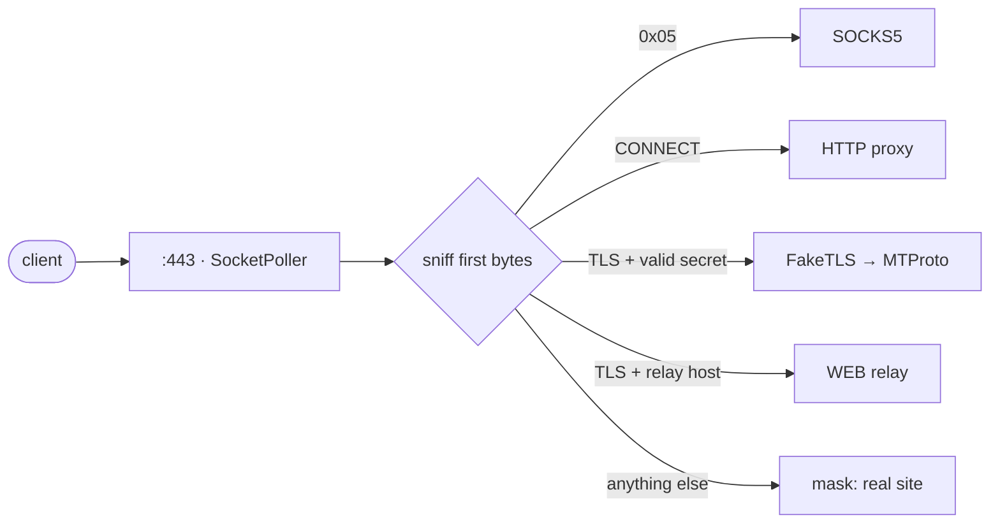

面向 Telegram 的小型原生代理 —— 单个二进制同时支持 MTProto、SOCKS5 与 WEB。使用 <a href="https://github.com/yukitsuri/yukino">Yukino</a> 编写。

<a href="README.md">English</a> · <a href="README.ru.md">Русский</a> · <b>简体中文</b> · <a href="README.es.md">Español</a> · <a href="README.tr.md">Türkçe</a> · <a href="README.fa.md">فارسی</a>

> <b>状态：pre-alpha，设计阶段。</b>尚无发布的二进制文件，本 README 描述目标与计划。

<table>
<tr><td align="center" width="25%"></td><td align="center" width="25%"></td><td align="center" width="25%"></td><td align="center" width="25%"></td></tr>
<tr><td valign="top" align="center"><code>dd</code> / <code>ee</code> 密钥、FakeTLS、多用户。</td><td valign="top" align="center">Telegram 通话。密码认证、ACL、限速。</td><td valign="top" align="center">为 Telegram Desktop 7.1+ 的 WEB 代理类型提供中继，走普通 HTTPS。</td><td valign="top" align="center">密钥错误或主动探测？对方只会看到真实网站。</td></tr>
</table>

## 我们发现的不足 → ypwee 的做法

<table>
<tr><th width="50%">现有代理的不足</th><th width="50%">ypwee</th></tr>
<tr><td valign="top">每个工具只支持一种协议。mtproto.zig 支持 MTProto + WEB，但自述不支持通话（无 SOCKS5）；tg-ws-proxy-rs 只是 Desktop 的本地桥接。</td><td valign="top">MTProto、SOCKS5、WEB 合一：一个二进制、一个端口、一份配置。</td></tr>
<tr><td valign="top">构建体积大。按 mtproto.zig 自己的对比表：Telemt ≈ 15 MB / 423 个 crate，mtg ≈ 13 MB。</td><td valign="top">Yukino 原生二进制——无虚拟机、无追踪式 GC。体积与内存将实测并公布，而非空口承诺。</td></tr>
<tr><td valign="top">大量连接保持时内存增长（tg-ws-proxy-rs issues #97、#113）。</td><td valign="top">每连接固定小状态、区域分配、CI 中做长时间压力测试。</td></tr>
<tr><td valign="top">运行时依赖第三方列表（tg-ws-proxy-rs 可从 GitHub 拉取 Cloudflare 域名列表）。</td><td valign="top">自包含，启动时不做任何远程拉取。</td></tr>
<tr><td valign="top">以 <code>curl | sudo bash</code> 作为主要安装方式。</td><td valign="top">GitHub Actions 发布构建、SHA-256 校验、来源证明，提供普通 tarball 安装。</td></tr>
<tr><td valign="top">SOCKS5 无法伪装成 HTTPS。</td><td valign="top">坦诚说明：SOCKS5 为可选项，需认证并限速。</td></tr>
</table>

## 一个端口如何服务所有协议

## 路线图

- <b>M0</b> — 设计、README、CI 骨架
- <b>M1</b> — SOCKS5 + HTTP CONNECT（最小切片，验证 <code>std.net</code> 与 <code>SocketPoller</code>）
- <b>M2</b> — MTProto obfuscated2（需要 AES-256-CTR，Yukino 的 <code>std.crypto</code> 暂无）+ <code>dd</code>/<code>ee</code> 密钥
- <b>M3</b> — FakeTLS + 抗主动探测伪装
- <b>M4</b> — WEB 中继（WebSocket RFC 6455 + Telegram 桥接帧）
- <b>M5</b> — 签名发布、安装器、与 mtg / Telemt / mtproto.zig 的基准对比

## 致谢与参考

- [Yukino](https://github.com/yukitsuri/yukino) — language, `std.net`, `std.crypto`
- [sleep3r/mtproto.zig](https://github.com/sleep3r/mtproto.zig) — MTProto + WEB relay in Zig (MIT)
- [valnesfjord/tg-ws-proxy-rs](https://github.com/valnesfjord/tg-ws-proxy-rs) · [Flowseal/tg-ws-proxy](https://github.com/Flowseal/tg-ws-proxy) — WebSocket bridge
- Telemt (Rust) · mtg (Go) · official MTProxy (C)

*许可证：待定（Yukino 本身为 Apache-2.0；移植自 MIT 项目的代码须保留其声明）。*
